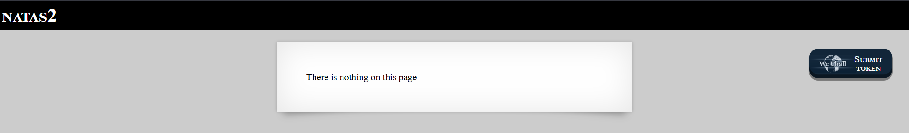
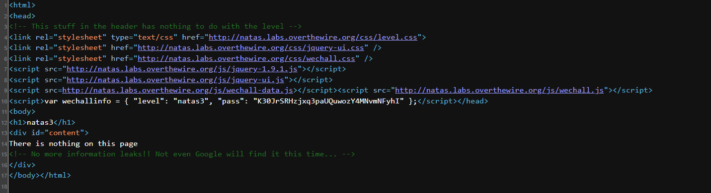
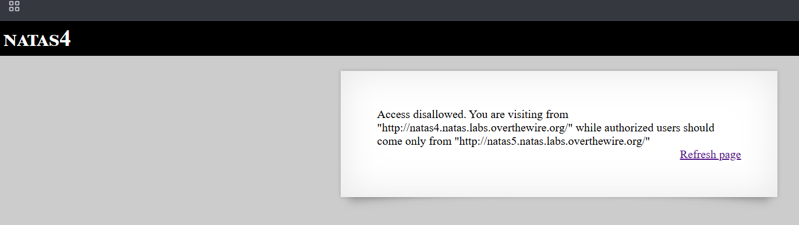
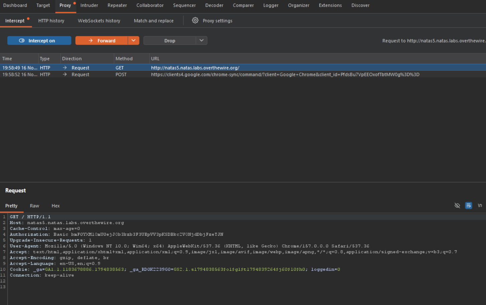
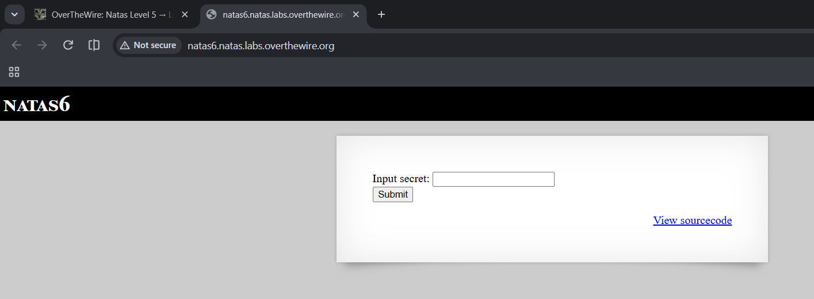
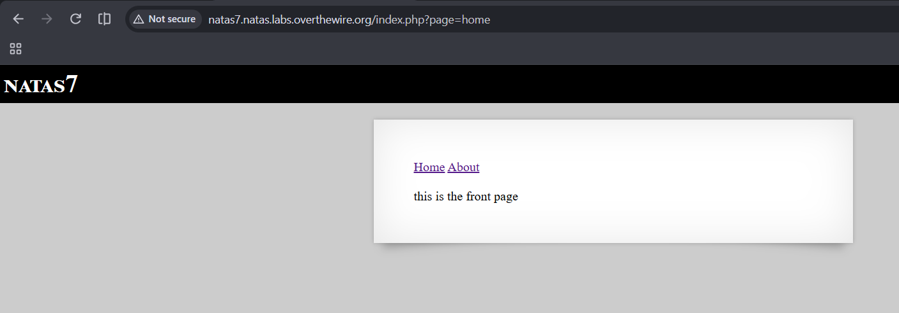
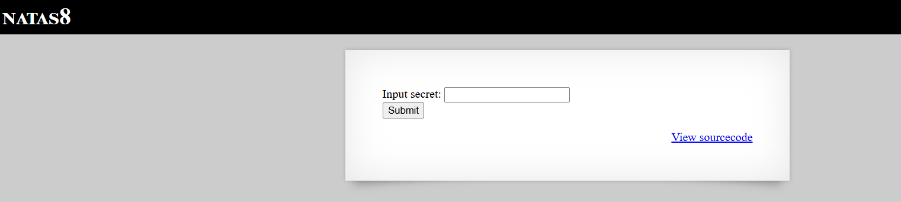

# Natas Labs Solution (OverTheWire)

**Date Solved:** November 2026

## 🚀 About This Repository

Welcome to my comprehensive, step-by-step learning log and writeup repository for the **OverTheWire: Natas** wargame!

🚨 **Important Note for Users:** This repository contains freshly solved Natas web security problems. It documents my methodology, technical analysis, tool usage, and core web vulnerability concepts (such as source code inspection, authorization bypass, command injection, and SQL injection) learned while conquering Natas. If this helps you on your cybersecurity journey, please consider giving the repository a Star! ⭐

## 🔗 Links

 

## 🧭 Labs Index (Levels 0 - 10)

- **[Level 0 (Natas 0 -> 1](#level-0)**
- **[Level 1 (Natas 1 -> 2)](#level-1)**
- **[Level 2 (Natas 2 -> 3)](#level-2)**
- **[Level 3 (Natas 3 -> 4)](#level-3)**
- **[Level 4 (Natas 4 -> 5)](#level-4)**
- **[Level 5 (Natas 5 -> 6)](#level-5)**
- **[Level 6 (Natas 6 -> 7)](#level-6)**
- **[Level 7 (Natas 7 -> 8)](#level-7)**
- **[Level 8 (Natas 8 -> 9)](#level-8)**
- **[Level 9 (Natas 9 -> 10)](#level-9)**
- **[Level 10 (Natas 10 -> 11)](#level-10)**

## 🚩 Master Flag List (Levels 0 - 10)

For quick reference, here are the passwords extracted from each level:

* **Level 0:** `natas0` *(Unlocks Level 0)*
* **Level 1:** `scfWG6qNEIdzqVyfRwEGXyNUfFZkZeQ7` *(Found at Level 0)*
* **Level 2:** `vsDOxoXyq3wckCP1ZmTZ71ngIA606odB` *(Found at Level 1)*
* **Level 3:** `K30JrSRHzjxq3paUQuwozY4MNvmNFyhI` *(Found at Level 2)*
* **Level 4:** `JDrPnuZAKyl6MkiqQGFIddrqpvgOASth` *(Found at Level 3)*
* **Level 5:** `e4z2Noy3oqwPJUWzJH0dseN67Cn1sy2M` *(Found at Level 4)*
* **Level 6:** `7mhjtShJAcld2NYbKHEadnhEwRn2P8VT` *(Found at Level 5)*
* **Level 7:** `B1szg95UcTnrzwnF3i3TzYHlyYh8iBV0` *(Found at Level 6)*
* **Level 8:** `ugXL95KQmUAJJj6bMezOlBNDyI9Imwkc` *(Found at Level 7)*
* **Level 9:** `UdxmI27dTaXmnd1rxKQTfws6jihTdcQ9` *(Found at Level 8)*
* **Level 10:** `EgjlkzB6E8LJyf2Obt4q7q4ewt5ZWSNv` *(Found at Level 9)*

---

## Level 0 -> Level 1

Well it is the 0th level ,all we need to do it open the url and use the credentials as mentioned. 

.png)

well the  page mentioned the flag is available here , so the first thing we need to do is to check the html content 
it can be done through 2 ways by right clicking and press inspect or pressing "ctrl + u" to access the html content of the webpage 

.png)
this is the output for ctrl+u which shows all the html contents without hiding any dropdown and easy to copy.

---

## Level 1 -> Level 2

In order to access the next level we need to use the username as nata1 and the flag we just got in the previous level 

.png)

The web page mentioned that the right clicking was disabled so we cant do the right click + inspect to analyze the html content, so we need to procced with ctrl + u 

.png)
As a result the password for next level was found 

---

## Level 2 -> Level 3

the page shown nothing in the page , so i inspected the html content 

.png)

I found a suspicious file path src = files/pixel.png

so, i clicked it 
as a result we can see the url changed to the path /files/pixel.png
.png)

It is a blank empty page and nothing in the html content too so we are moving to the parent directory from "/files/pixel.png/" to "/files/"
which can be done through url editing 

.png)

as a result it shows that the apache servers file  contents are exposes 

.png)

when you click the users.txt  file  it shows the flag 
---

## Level 3 -> Level 4

the page shows no leaked contents and even the google cant find it ,and we cant find anything in html 

robots.txt file is a simple text file placed in a website's root directory that tells search engine crawlers and other automated bots which pages or files they are allowed or not allowed to access.

.png)

as a result of editing the url to /robots.txt at the end we can find that it have some secret path exposed 

.png)

when we use that /s3cr3t/ path we can find some apache servers file contents are exposed  

.png)

by checking the users.txt  we can find the flag

---

## Level 4 -> Level 5

Writeups for the level 4 to 5

.png)

Writeups for the level 4 to 5

.png)

Writeups for the level 4 to 5

.png)

---

## Level 5 -> Level 6

Writeups for the level 5 to 6

.png)

---

## Level 6 -> Level 7

Writeups for the level 6 to 7

.png)

Writeups for the level 6 to 7

.png)

Writeups for the level 6 to 7

.png)

Writeups for the level 6 to 7

.png)

---

## Level 7 -> Level 8

Writeups for the level 7 to 8

.png)

Writeups for the level 7 to 8

.png)

Writeups for the level 7 to 8

.png)

---

## Level 8 -> Level 9

Writeups for the level 8 to 9

.png)

Writeups for the level 8 to 9

.png)

Writeups for the level 8 to 9

.png)

Writeups for the level 8 to 9

.png)

---

## Level 9 -> Level 10

.png)

Writeups for the level 9 to 10

.png)

Writeups for the level 9 to 10

.png)

Writeups for the level 9 to 10

.png)

Writeups for the level 9 to 10

.png)

---

## Level 10 -> Level 11

**Password / Flag:** `EgjlkzB6E8LJyf2Obt4q7q4ewt5ZWSNv` *(cat /etc/natas_passwd/natas10)*
